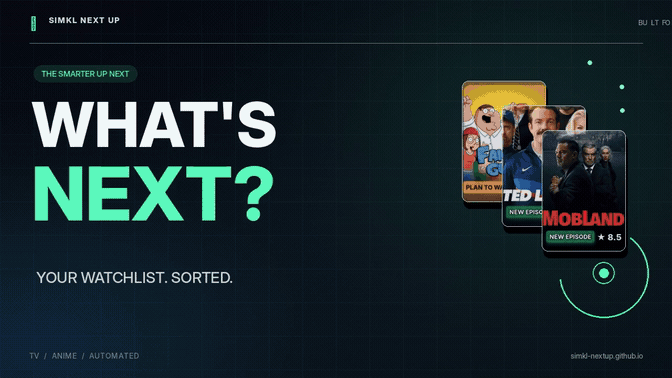

<div align="center">

# Simkl Next Up

### Your watchlists. Your release calendar.

**Anime and TV Up Next, plus Account 2 movie digital/physical home-release tracking for Stremio and Nuvio.**  
Powered by [Simkl](https://simkl.com) · Hosted on GitHub Pages · Open source

[**Anime addon**](https://simkl-nextup.github.io/manifest.json) · [**TV addon**](https://simkl-nextup.github.io/account-2/manifest.json) · [**Poster Studio**](https://simkl-nextup.github.io/studio.html)

</div>

## See it in action

[](assets/promo/simkl-nextup-X-landscape-16x9.mp4)

**▶ [Watch the full 18-second promo (landscape)](assets/promo/simkl-nextup-X-landscape-16x9.mp4)**  
**↗ [Watch the vertical version (Reels / Shorts / TikTok)](assets/promo/simkl-nextup-vertical-1080x1920.mp4)**

*The preview above is an animated GIF that plays directly in GitHub's README. Click it for the full MP4 with sound. Depending on the browser, GitHub may open or download the MP4.*

## What it does

Simkl Next Up creates personalized **Up Next** catalogs from your Simkl watchlists. New releases move their shows toward the front, while custom posters make episode progress easy to recognize at a glance.

- **Watching:** Shows the next unwatched episode when it has aired.
- **Plan to Watch:** Includes titles that have at least one released episode.
- **Completed:** Brings a title back when new episodes become available.
- **Episode awareness:** Distinguishes the *latest aired episode* from the *next unwatched episode*.
- **Clean episode catalogs:** Excludes dropped/on-hold titles and episodes that have not aired; movies live in a separate new Account 2 row.
- **Automatic refresh:** GitHub Actions refreshes the catalogs hourly (scheduled for minute `:23`).

The addon **provides catalogs and metadata, not video streams**. Playback still comes from your Stremio/Nuvio streaming addons.

## Two addon URLs, three catalog rows

| | Anime | TV series |
|---|---|---|
| Simkl library | Account 1 — anime | Account 2 — TV shows |
| Addon URL | [`/manifest.json`](https://simkl-nextup.github.io/manifest.json) | [`/account-2/manifest.json`](https://simkl-nextup.github.io/account-2/manifest.json) |
| State and catalog | Separate | Separate |
| Poster settings | Independent | Independent |

The Account 2 addon is optional: configure `SIMKL_ACCESS_TOKEN_2` to enable it. That same addon now publishes **two rows** (TV series and movie home releases), while the primary anime addon remains independent. The movie row requires the existing `TMDB_READ_ACCESS_TOKEN` secret.

## New: Account 2 movie home-release row

**No second install or second manifest URL.** After deployment, the existing `/account-2/manifest.json` provides both **TV Up Next** (`series`) and **Movies · Home Releases** (`movie`). Films come from Account 2's Simkl **Plan to Watch** list. The movie row:

- Ignores theatrical/premiere/TV broadcast dates completely.
- Shows **Coming Soon** only if a known digital (TMDB type 4) or physical (type 5) release falls within **30 days**.
- Shows **released** films when either format has actually been released anywhere; US release information is favored once available, with worldwide fallbacks.
- Shows all released movies first, ordered by their most recent actual home-release event, and Coming Soon titles afterward, nearest upcoming release first.
- Updates automatically to **Digital**, **Physical**, or **Digital + Physical**; a newly released format can bump a movie toward the front.
- Never bumps a title merely because it was added late to your Simkl list. Removing it from Plan to Watch removes it from the row.
- Uses `https://btttr.cc/poster/imdb/poster-default/{imdb_id}.jpg?tag=none` for the **base BetterPosters image** and injects custom release/date tags locally across the top. A TMDB poster is used when BetterPosters fails or IMDb is missing; the release tag overlay is always generated by this addon.

**Source limitations:** TMDB's country-specific release dates are community-entered and can be missing, delayed, or incorrect; a recorded release date is not a guarantee that a stream or disc is available in every country. No additional source or secret is required beyond your already-integrated TMDB token. No separate movie Poster Studio control has been added. Details and troubleshooting: [`MOVIE_ROW.md`](MOVIE_ROW.md).

## Artwork and customization

- Custom poster labels for **New Episode**, **Plan to Watch**, and **New Season**.
- **Latest aired** and **next unwatched** episode information on supported titles.
- TMDB artwork, title logos, and TV ratings (when available).
- TheTVDB metadata, seasons, episode stills, and grouping of related series records (when configured).
- Anime extras: MyAnimeList scores and optional English-dub progress via AnimeSchedule.
- **[Poster Studio](https://simkl-nextup.github.io/studio.html):** Customize the anime and TV rows separately with *Tags* or *Classic* looks, then preview your settings.

Poster preferences are saved in [`config/poster-style.json`](config/poster-style.json). Some enriched metadata and episode labels depend on the accuracy of their upstream sources.

## Set up your own deployment

**Requirements:** Node.js 20.9+ for local use, a GitHub repository with Actions and Pages enabled, and a Simkl developer application.

1. **Fork or upload the project** to a GitHub repository, preserving its folder structure.
2. In **Settings → Pages**, choose **GitHub Actions** as the source.
3. Run **Actions → Deploy setup page only** to publish the authorization page.
4. Create a client ID in [Simkl developer settings](https://simkl.com/settings/developer/), then visit your deployed `/setup.html` and authorize Account 1.
5. Add `SIMKL_CLIENT_ID` and `SIMKL_ACCESS_TOKEN` under **Settings → Secrets and variables → Actions → Repository secrets**.
6. Optionally configure Account 2 using the instructions in [`SECOND_ACCOUNT_SETUP.md`](SECOND_ACCOUNT_SETUP.md).
7. Run **Actions → Refresh Simkl anime, TV and home-release movies**. Once it succeeds, install the appropriate manifest URL in Stremio or import it through your Nuvio setup.

### Credentials

| Secret | Purpose |
|---|---|
| `SIMKL_CLIENT_ID` | **Required.** Simkl application client ID |
| `SIMKL_ACCESS_TOKEN` | **Required.** Account 1 access token |
| `SIMKL_ACCESS_TOKEN_2` | Second Simkl account (TV + movies) |
| `SIMKL_CLIENT_ID_2` | Optional separate client ID for account 2 |
| `TMDB_READ_ACCESS_TOKEN` | **Required for Account 2 movies**; also artwork, logos, TV ratings |
| `TVDB_API_KEY` | Optional: series/episode details and season grouping |
| `TVDB_SUBSCRIBER_PIN` | Only if required by your TVDB subscription |
| `MDBLIST_API_KEY` | Optional external-ID mapping fallback |
| `ANIMESCHEDULE_TOKEN` | Optional English-dub status for anime |

For TVDB, leave the repository variables `TVDB_LANGUAGE` and `TVDB_SEASON_TYPE` unset unless you need nondefault settings. Set `PUBLIC_BASE_URL` only if hosting under a custom domain.

**Never commit your access tokens or API keys.** The generated catalogs are public, but credentials and sync state are not meant to be deployed.

## How it works

```text
Simkl watchlists and episode calendars
            ↓
GitHub Actions (hourly refresh)
            ↓
Optional TMDB / TVDB / anime metadata
            ↓
Episode selection + poster generation
            ↓
GitHub Pages: manifests, catalogs, metadata, posters
            ↓
Stremio / Nuvio
```

Updates use Simkl activity checks and cached metadata to avoid unnecessary full-library downloads. The workflow verifies its outputs before deploying; a failed generation does not replace an existing successful Pages deployment. Scheduled workflows can occasionally run late.

### Repository layout

```text
simkl-nextup.github.io/
├── README.md                    ← this page, including the promo
├── assets/
│   ├── promo/                   ← promo files live HERE (not in public/)
│   │   ├── nextup-preview.gif                ← auto-playing README preview
│   │   ├── simkl-nextup-X-landscape-16x9.mp4 ← X + full README video
│   │   ├── simkl-nextup-vertical-1080x1920.mp4 ← Reels / Shorts / TikTok
│   │   ├── simkl-nextup-promo-cover-X.jpg
│   │   └── simkl-nextup-promo-cover-vertical.jpg
│   ├── studio.html              ← Poster Studio source
│   └── fonts/                   ← bundled poster font and license
├── config/poster-style.json     ← per-feed poster preferences
├── src/                         ← catalog, metadata, posters, episode logic
├── scripts/                     ← sync, verification, authorization
├── tests/                       ← automated tests
├── .github/workflows/           ← deployment and refresh jobs
├── public/                      ← generated Pages content (rebuilt by sync)
│   └── account-2/               ← generated TV addon
└── SECOND_ACCOUNT_SETUP.md      ← second-account guide
```

**Promo upload instructions:** Upload `README.md` to the **repository root** and the five media files to **`assets/promo/`**, preserving the filenames. You do **not** need to change the GitHub Actions workflow for the README preview: GitHub serves these files directly from the repository. Do **not** place promo files inside `public/`; the refresh process rebuilds that folder and would delete them.

### Local development

```bash
npm ci
npm test
npm run build:placeholder
# After configuring environment variables:
npm run refresh
npm run verify
```

## Status and privacy

- Check the generated [`status.json`](https://simkl-nextup.github.io/status.json) and [TV status](https://simkl-nextup.github.io/account-2/status.json) to inspect the current published catalogs.
- Simkl tokens and metadata caches are managed through GitHub Secrets and private Actions caches, not committed to the public repository.
- The resulting catalogs, poster images, and promo media are public, as required for client access and sharing.

## Credits and license

Watchlist and schedule data: [Simkl](https://simkl.com). Artwork and supplementary metadata: [TMDB](https://www.themoviedb.org), [TheTVDB](https://thetvdb.com), and optional anime metadata services. This product uses the TMDB API but is **not endorsed or certified by TMDB**. See [`LICENSE`](LICENSE) for the project license.
